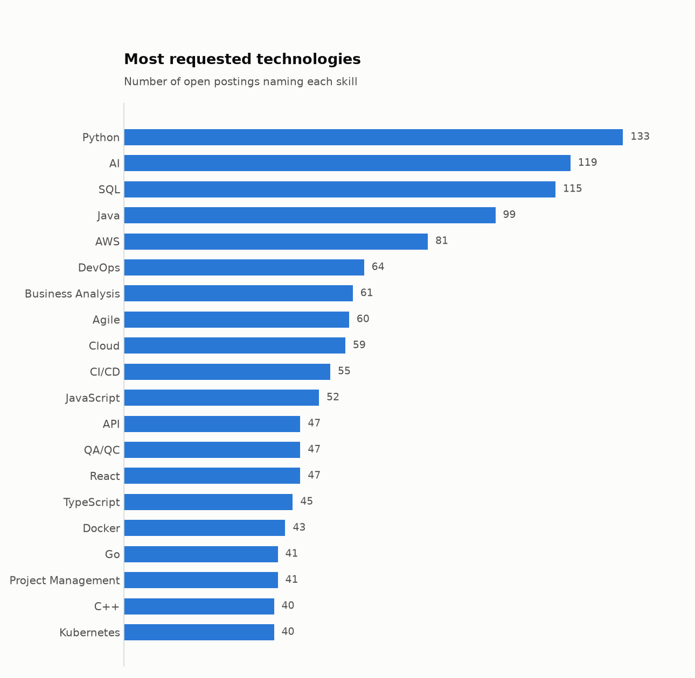
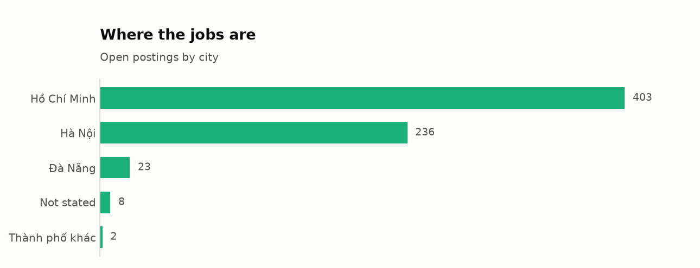
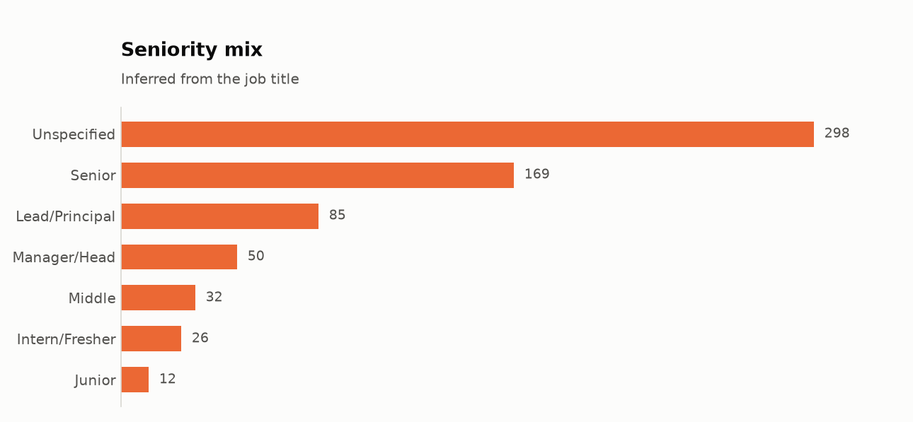
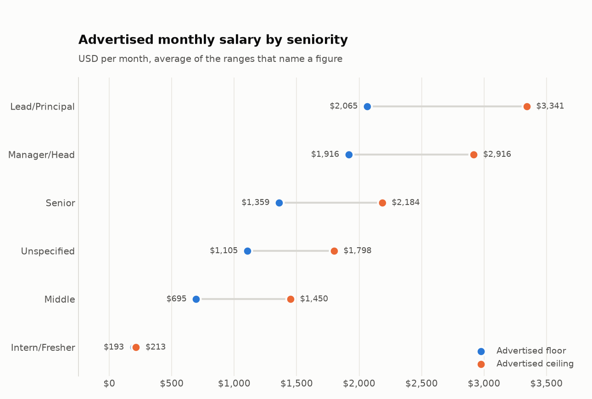

# Findings

Based on 672 IT job postings collected from the ITviec public sitemap. Every number below comes from a SQL query in `src/analyze.py`.

## 1. Most postings do not name a salary

Only **183 of 672 postings (27.2%)** publish a figure. The rest replace the number with a slogan such as "You'll love it", so a candidate cannot compare offers before applying. Any salary figure in this report therefore describes the minority of employers willing to post one, not the market as a whole.

## 2. English is a listed requirement, not a bonus

English appears as a required skill on **28%** of postings, which puts it among the most requested items of any kind - ahead of most individual technologies.

## 3. What employers actually ask for

Top ten requested technologies:

| # | Skill | Postings | Share |
|---|-------|---------:|------:|
| 1 | Python | 133 | 19.8% |
| 2 | AI | 119 | 17.7% |
| 3 | SQL | 115 | 17.1% |
| 4 | Java | 99 | 14.7% |
| 5 | AWS | 81 | 12.1% |
| 6 | DevOps | 64 | 9.5% |
| 7 | Business Analysis | 61 | 9.1% |
| 8 | Agile | 60 | 8.9% |
| 9 | Cloud | 59 | 8.8% |
| 10 | CI/CD | 55 | 8.2% |

## 4. The market is concentrated in one city

**Hồ Chí Minh** holds 403 of 672 postings (60%).

| City | Postings |
|------|---------:|
| Hồ Chí Minh | 403 |
| Hà Nội | 236 |
| Đà Nẵng | 23 |
| Not stated | 8 |
| Thành phố khác | 2 |

## 5. Advertised pay by seniority

Averages over postings that name a USD range. Groups with fewer than five such postings are left out.

| Seniority | Postings | Avg floor | Avg ceiling |
|-----------|---------:|----------:|------------:|
| Lead/Principal | 22 | $2,065 | $3,341 |
| Manager/Head | 15 | $1,916 | $2,916 |
| Senior | 53 | $1,359 | $2,184 |
| Unspecified | 72 | $1,105 | $1,798 |
| Middle | 8 | $695 | $1,450 |
| Intern/Fresher | 10 | $193 | $213 |

## Charts

## Limitations

- One job board only, so the figures describe ITviec's listings rather than every IT vacancy in Vietnam.
- A snapshot of currently open postings, not a time series.
- `monthsOfExperience` arrives pre-bucketed by the source, so it is reported as a band and not treated as a precise number.
- Seniority is inferred from the job title, so postings with a vague title fall into "Unspecified".
- Salary figures cover only the postings that disclose one, which biases them toward employers competing openly on pay.
